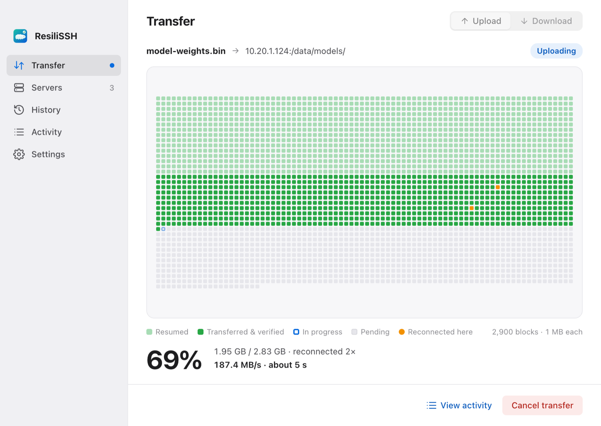
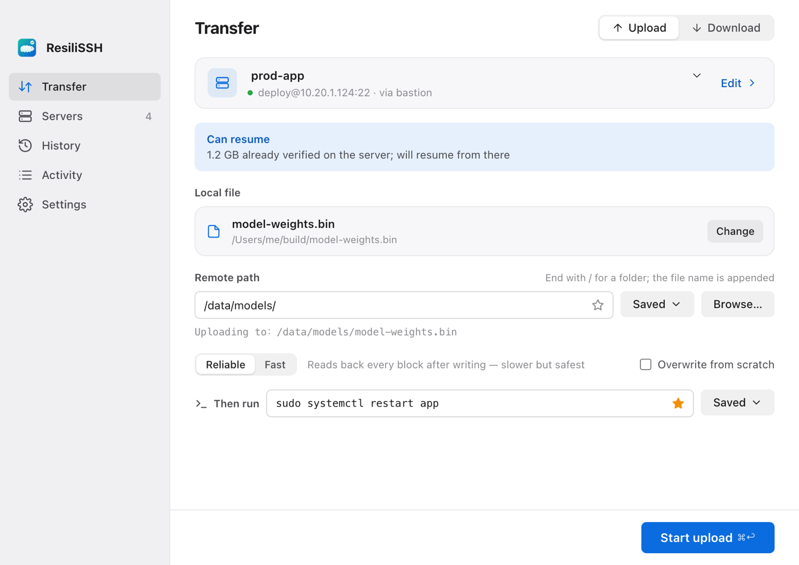
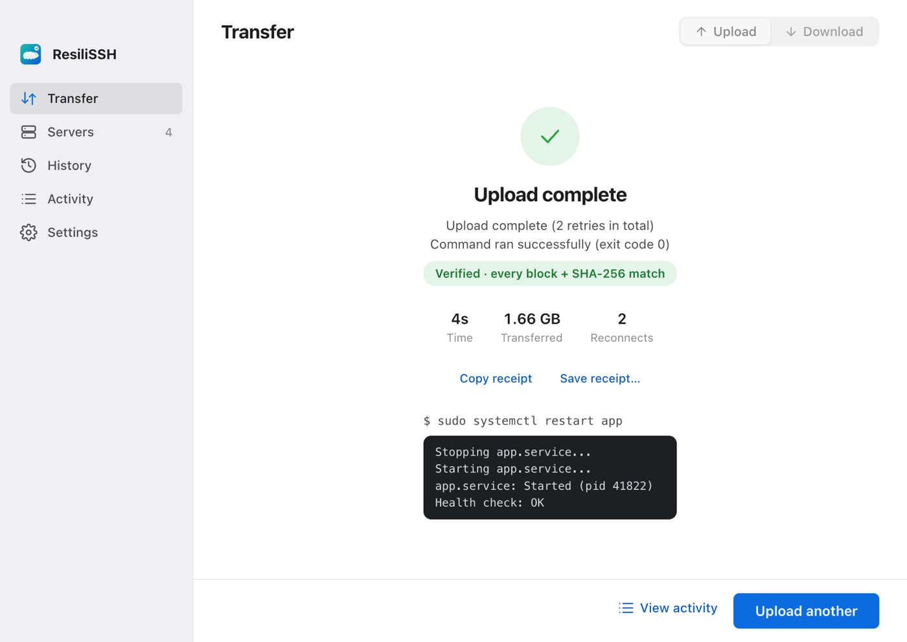
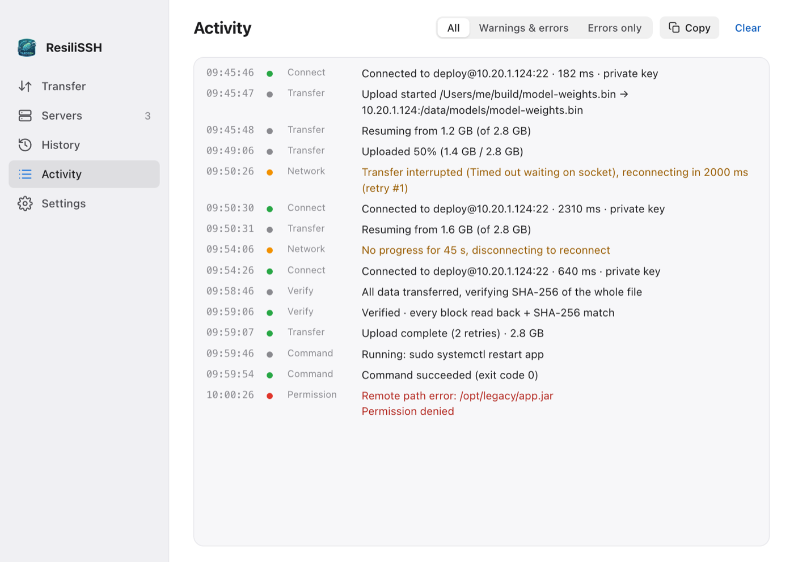

<p align="center">
  
</p>

<h1 align="center">ResiliSSH</h1>

<p align="center">
  <b>Get files to your server reliably — and know they arrived intact.</b><br />
  A focused SFTP transfer app for macOS: resumes after any interruption, verifies every byte.
</p>

<p align="center">
  English · <a href="./README.zh-CN.md">简体中文</a>
</p>

<p align="center">
  
</p>

## Why

Copying a large file over SFTP sounds trivial until the VPN drops at 87%, the hotel Wi‑Fi stalls for a minute, or you're left wondering whether the file on the server is actually the file you sent.

ResiliSSH treats every transfer as something that **must finish correctly**:

- **It never gives up on the network.** Timeouts, resets and stalls trigger automatic reconnection with backoff, forever — until the transfer completes or you cancel.
- **It never starts over.** Progress is checkpointed in 1 MB blocks. After a crash, a reboot or a cancel, the next run continues from the last verified block.
- **It proves the result.** In *Reliable* mode every block is read back and compared after writing; every transfer ends with a full SHA-256 comparison of local and remote files.

## Features

**Transfer**
- Upload and download files one at a time or in **batches** — drag in several files or a **whole folder**, or multi-select remote files and folders to download (folder structure is kept both ways)
- **Preflight**: refuses early if the destination disk (server or local) is out of space; skips files that are already identical (SHA-256) in either direction
- Block-level resume with integrity check at the resume boundary
- Two modes: *Reliable* (read back every block) and *Fast* (verify once at the end)
- A live **block map** shows what was resumed, what's verified, where the connection dropped
- **Then run** — optionally execute a command on the server after a verified upload (e.g. `sudo systemctl restart app`), with `{remote_dir}` `{file_name}` `{remote_path}` `{files}` variables safely shell-quoted

**Trust & security**
- **Host key verification** against `~/.ssh/known_hosts`; unknown hosts must be confirmed by fingerprint, changed keys are refused
- Passwords and key passphrases live in the **macOS Keychain**, never in config files — or, per server, aren't stored at all
- Private keys stay where they are; `ssh-agent` is supported

**Everyday comfort**
- Saved servers, import from `~/.ssh/config`, connection test
- Bookmarked and recent remote folders per server
- History with one-click reuse; unfinished transfers listed with a *Resume* button, and offered again on launch
- **Activity log**: every connect, auth, reconnect, permission error and verification step, filterable and copyable
- macOS notifications, light/dark theme, English and Chinese UI

<table>
  <tr>
    <td></td>
    <td></td>
  </tr>
  <tr>
    <td align="center">Pick a server, a file and a destination</td>
    <td align="center">Verified, then the service restarted</td>
  </tr>
  <tr>
    <td colspan="2"></td>
  </tr>
  <tr>
    <td colspan="2" align="center">The activity log tells you exactly what happened</td>
  </tr>
</table>

## What it is not

ResiliSSH deliberately stays small. It is **not**:

- a dual-pane file manager or a FileZilla replacement
- an SSH terminal or port-forwarding tool
- a deployment / CI system (no multi-server fan-out, no pipelines, no folder watching)

If you need those, great tools already exist. ResiliSSH does one job: getting files there, intact.

## How it compares

| | ResiliSSH | scp | rsync -P | Typical SFTP client |
|---|---|---|---|---|
| Automatic reconnect & resume | ✅ unlimited | ❌ | manual re-run | varies |
| Per-block read-back verification | ✅ | ❌ | ❌ | rare |
| Whole-file check after transfer | ✅ SHA-256 | ❌ | ✅ built-in checksum | rarely |
| Host key confirmation UI | ✅ | terminal prompt | terminal prompt | ✅ |
| Learning curve | fill a form | CLI | CLI | feature-heavy |

## Install

**Requirements:** macOS on Apple Silicon or Intel. Developed and tested on recent macOS releases; older versions are untested.

### Download

Grab the latest `.dmg` from [Releases](https://github.com/dushuning/ResiliSSH/releases) and drag ResiliSSH into Applications.

> Builds are not notarized yet. If macOS blocks the first launch, right-click the app and choose **Open**. Until builds are signed, macOS may also ask once per build to allow Keychain access — choose **Always Allow**.

### Build from source

```bash
git clone https://github.com/dushuning/ResiliSSH.git
cd ResiliSSH
npm install
npm run app            # release build → src-tauri/target/release/bundle/
```

## Usage

1. **Servers** — add a server or import one from `~/.ssh/config`, then *Test connection*. The first connection asks you to confirm the server's fingerprint.
2. **Transfer** — choose the server, drop one or more files, set the remote folder (end with `/`).
3. Optionally fill in **Then run** with a command to execute after a successful upload.
4. Press **Start upload** (⌘↩). If the network drops, just wait — it reconnects and resumes on its own.
5. Closed the app mid-transfer? Open **History** and press **Resume**.

Keyboard: ⌘1–⌘5 switch pages, ⌘O picks a file, ⌘↩ starts.

## Where your data lives

| What | Where |
|---|---|
| Passwords & passphrases | macOS Keychain (service `com.resiliss.desktop`) |
| Saved servers, checkpoints, history (last 30) | `~/Library/Application Support/sshutil/` |
| Host keys you trusted in the app | `~/Library/Application Support/sshutil/known_hosts` (your `~/.ssh/known_hosts` is read, never modified) |
| Diagnostic logs | `~/Library/Logs/com.resiliss.desktop/` |

ResiliSSH has no telemetry and makes no network connections other than to the servers you configure.

## Development

Prerequisites: [Rust](https://www.rust-lang.org/tools/install) (stable) and Node.js 18+.

```bash
npm install
npm run tauri dev       # run with hot reload
npm run check:i18n      # every UI string has an English translation
cd src-tauri && cargo test
```

| Layer | Tech |
|---|---|
| Shell | [Tauri 2](https://tauri.app/) |
| Backend | Rust · [ssh2](https://crates.io/crates/ssh2) (libssh2, vendored OpenSSL) · keyring |
| Frontend | TypeScript · Vite, no framework |

**Translations** use the Chinese source text as the key (gettext style): `t("开始上传")` → `src/i18n/en.ts`. To add a language, add a dictionary next to `en.ts`; backend messages use `tr!(zh, en)` in `src-tauri/src/i18n.rs`.

Contributions are welcome — please open an issue to discuss larger changes first. See [ROADMAP.md](./ROADMAP.md) for direction and [CHANGELOG.md](./CHANGELOG.md) for history.

## License

[MIT](./LICENSE)
