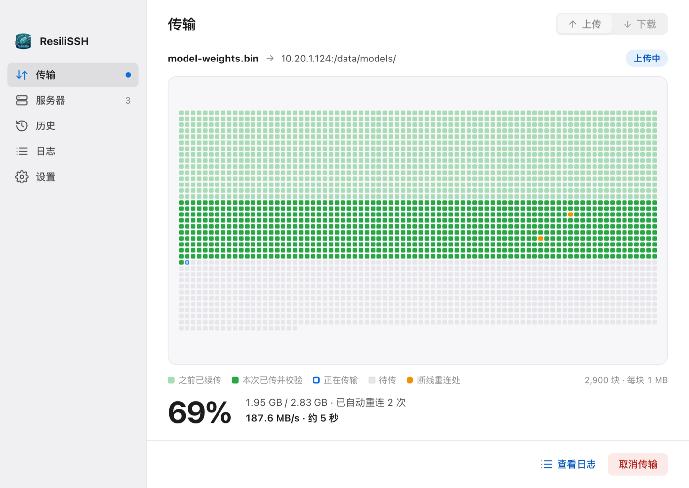
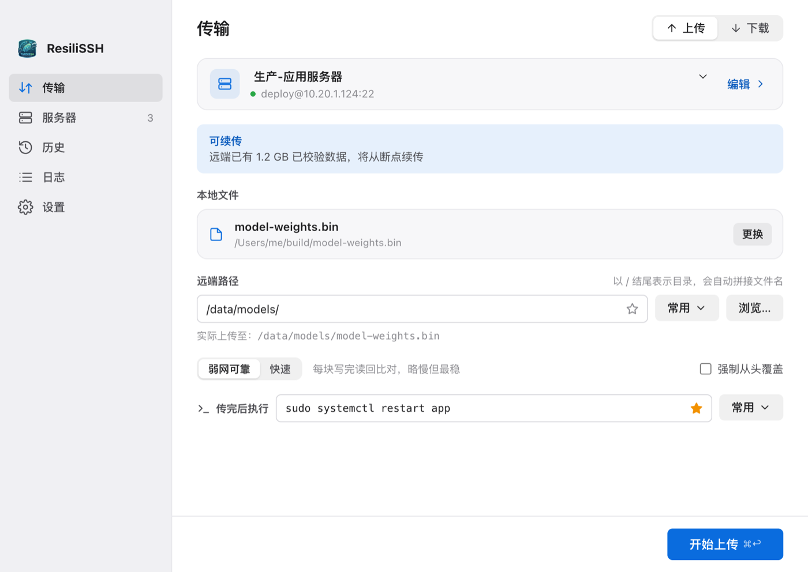
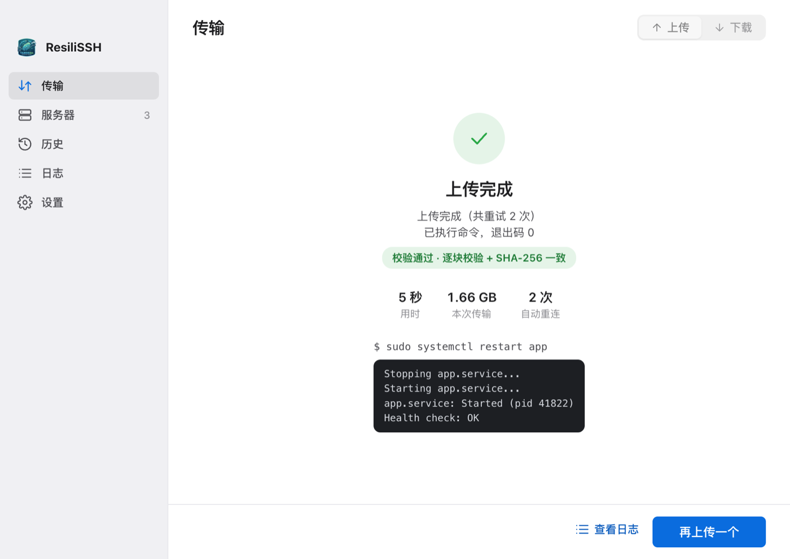
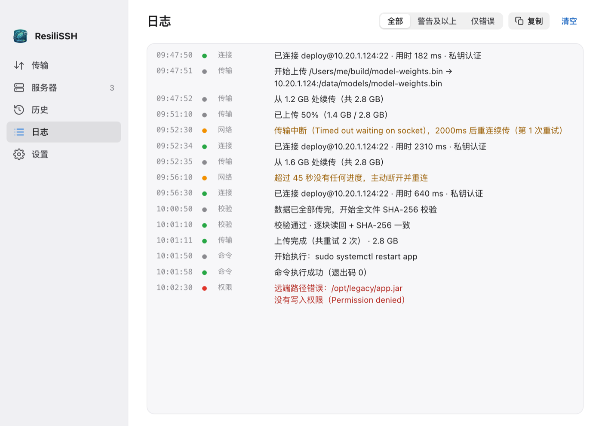

<p align="center">
  
</p>

<h1 align="center">ResiliSSH</h1>

<p align="center">
  <b>把文件可靠地送到服务器，并确认送到了。</b><br />
  一个专注的 macOS SFTP 传输工具：断了接着传，传完逐字节校验。
</p>

<p align="center">
  <a href="./README.md">English</a> · 简体中文
</p>

<p align="center">
  
</p>

## 为什么

用 SFTP 传个大文件听起来很简单——直到 VPN 在 87% 时断开、酒店 Wi‑Fi 卡住一分钟，或者传完之后你根本不确定服务器上的文件和本地是不是同一个。

ResiliSSH 把每一次传输都当成**必须正确完成**的事：

- **网络问题永不放弃。** 超时、连接重置、长时间无响应都会自动退避重连，一直到传完或你主动取消。
- **永不从头再来。** 进度按 1 MB 块记录断点。应用崩溃、电脑重启或手动取消后，下次从最后一个已校验的块继续。
- **结果可以证明。** 「弱网可靠」模式下每块写完都读回比对；每次传输结束都对本地和远端文件做完整的 SHA-256 比对。

## 功能

**传输**
- 上传、下载单个文件，或一次拖入**多个文件排队上传**
- 块级断点续传，续传前校验断点边界
- 两种模式：弱网可靠（逐块读回比对）、快速（只在最后整体校验）
- 实时**分块地图**：哪些是之前续传的、哪些已校验、在哪里断过线，一眼可见
- **传完后执行**：上传校验通过后可在服务器上执行命令（如 `sudo systemctl restart app`），支持 `{remote_dir}` `{file_name}` `{remote_path}` `{files}` 变量，并自动做 shell 转义

**可信与安全**
- **服务器指纹校验**：对照 `~/.ssh/known_hosts`；首次连接需核对指纹确认，指纹变化直接拒绝
- 密码与私钥口令保存在 **macOS 钥匙串**，不写入任何配置文件
- 私钥文件保持原位，支持 `ssh-agent`

**日常顺手**
- 保存服务器、从 `~/.ssh/config` 导入、测试连接
- 每台服务器的收藏目录与最近使用目录
- 传输历史一键复用；未完成的传输集中列出，可一键继续
- **活动日志**：连接、认证、重连、权限错误、校验的每一步，可筛选、可复制
- 系统通知、浅色 / 深色主题、中英文界面

<table>
  <tr>
    <td></td>
    <td></td>
  </tr>
  <tr>
    <td align="center">选服务器、选文件、填目标目录</td>
    <td align="center">校验通过，随后重启服务</td>
  </tr>
  <tr>
    <td colspan="2"></td>
  </tr>
  <tr>
    <td colspan="2" align="center">活动日志告诉你到底发生了什么</td>
  </tr>
</table>

## 它不是什么

ResiliSSH 刻意保持小而专注，它**不是**：

- 双栏文件管理器，也不打算替代 FileZilla
- SSH 终端或端口转发工具
- 部署 / CI 系统（不做多服务器分发、流水线、监视文件夹自动上传）

这些需求已有很好的工具。ResiliSSH 只做一件事：把文件完好地送到。

## 与其他工具对比

| | ResiliSSH | scp | rsync -P | 常见 SFTP 客户端 |
|---|---|---|---|---|
| 自动重连并续传 | ✅ 不限次数 | ❌ | 需手动重跑 | 因工具而异 |
| 逐块读回校验 | ✅ | ❌ | ❌ | 少见 |
| 传完整体校验 | ✅ SHA-256 | ❌ | ✅ 内置校验和 | 少见 |
| 指纹确认界面 | ✅ | 终端提示 | 终端提示 | ✅ |
| 上手成本 | 填表即用 | 命令行 | 命令行 | 功能多、偏重 |

## 安装

**系统要求：** macOS（Apple Silicon 或 Intel）。在较新的 macOS 版本上开发和测试，旧版本未经测试。

### 下载

从 [Releases](https://github.com/dushuning/ResiliSSH/releases) 下载最新的 `.dmg`，把 ResiliSSH 拖进「应用程序」。

> 目前的安装包尚未经过 Apple 公证。首次打开如被系统拦截，请右键点击应用选择**打开**。在签名之前，每个新版本可能会询问一次是否允许访问钥匙串，请选择**始终允许**。

### 从源码构建

```bash
git clone https://github.com/dushuning/ResiliSSH.git
cd ResiliSSH
npm install
npm run app            # Release 构建，产物在 src-tauri/target/release/bundle/
```

## 使用

1. **服务器**页：添加服务器或从 `~/.ssh/config` 导入，点「测试连接」。首次连接会请你核对并确认服务器指纹。
2. **传输**页：选服务器，拖入一个或多个文件，填写远端目录（以 `/` 结尾）。
3. 需要的话在「传完后执行」里填写上传成功后要执行的命令。
4. 点「开始上传」（⌘↩）。网络断了不用管，它会自己重连续传。
5. 传输中关掉了应用？打开**历史**页，点「继续」。

快捷键：⌘1–⌘5 切换页面，⌘O 选择文件，⌘↩ 开始传输。

## 数据存放位置

| 内容 | 位置 |
|---|---|
| 密码与私钥口令 | macOS 钥匙串（服务名 `com.resiliss.desktop`） |
| 已保存的服务器、断点、历史（最近 30 条） | `~/Library/Application Support/sshutil/` |
| 在应用中信任的服务器指纹 | `~/Library/Application Support/sshutil/known_hosts`（只读取你的 `~/.ssh/known_hosts`，从不修改） |
| 诊断日志 | `~/Library/Logs/com.resiliss.desktop/` |

ResiliSSH 不收集任何数据，除了你配置的服务器外不发起任何网络连接。

## 开发

需要 [Rust](https://www.rust-lang.org/tools/install)（stable）和 Node.js 18+。

```bash
npm install
npm run tauri dev       # 开发模式（热更新）
npm run check:i18n      # 检查界面文案是否都有英文翻译
cd src-tauri && cargo test
```

| 层 | 技术 |
|---|---|
| 桌面壳 | [Tauri 2](https://tauri.app/) |
| 后端 | Rust · [ssh2](https://crates.io/crates/ssh2)（libssh2，内置 OpenSSL）· keyring |
| 前端 | TypeScript · Vite，无框架 |

**多语言**采用 gettext 风格，以中文原文作为 key：`t("开始上传")` → `src/i18n/en.ts`。新增语言只需在 `en.ts` 旁边加一份字典；后端文案在 `src-tauri/src/i18n.rs` 中用 `tr!(中文, English)`。

欢迎贡献——较大的改动请先开 issue 讨论。发展方向见 [ROADMAP.md](./ROADMAP.md)，版本历史见 [CHANGELOG.md](./CHANGELOG.md)。

## 许可证

[MIT](./LICENSE)
